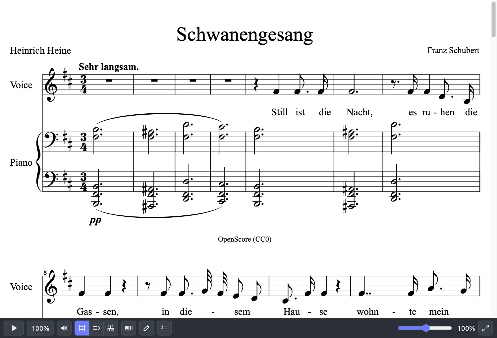
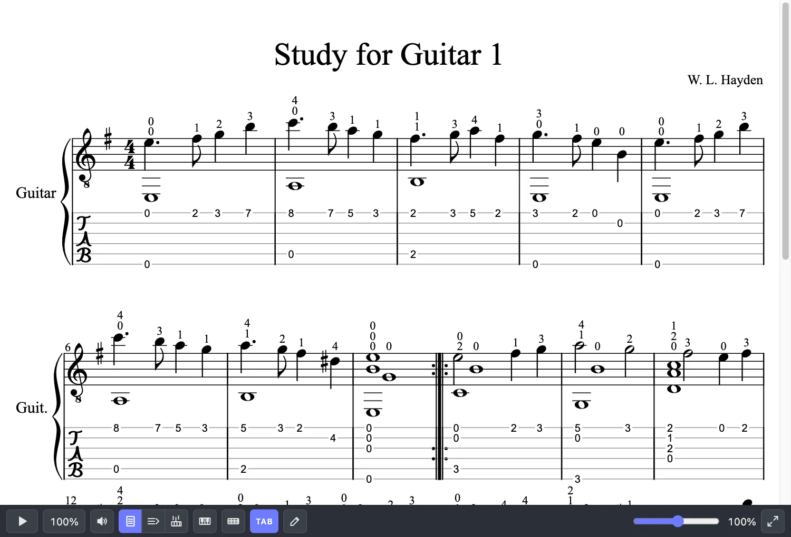
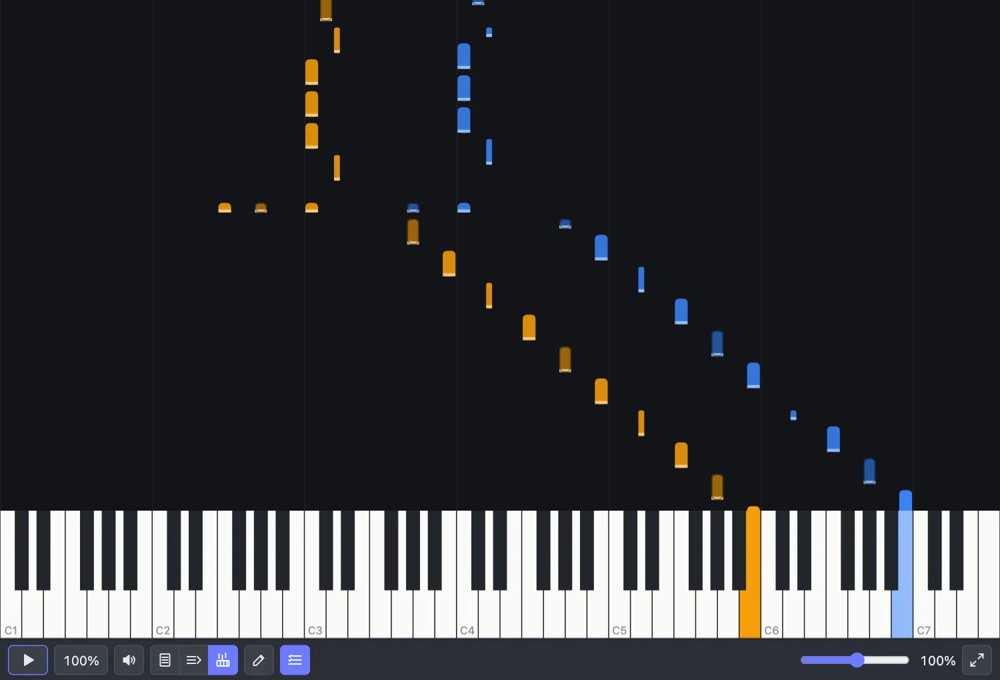
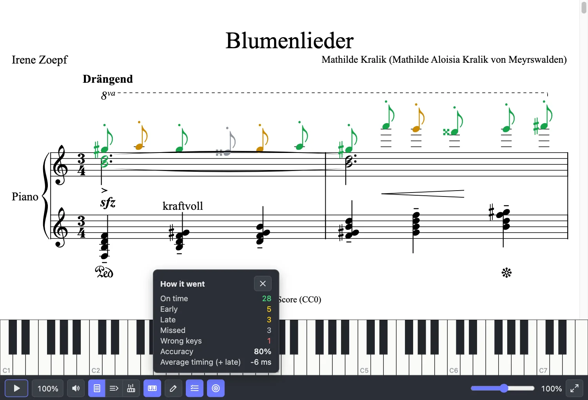
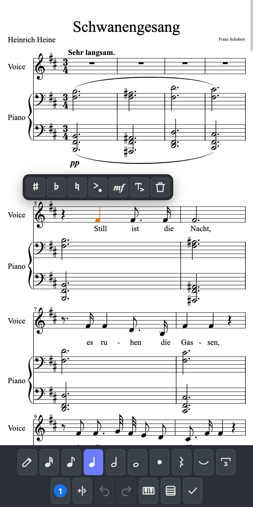

# scoredit

A music score viewer and editor that runs entirely in the browser. It opens MusicXML,
MuseScore, Guitar Pro, MIDI, ABC and score PDFs, plays them, and edits them with real note
entry by touch, mouse, computer keyboard or MIDI keyboard, on phones as well as desktops.
Engraving is done by [OpenSheetMusicDisplay](https://github.com/opensheetmusicdisplay/opensheetmusicdisplay),
one system (line) at a time: scoredit breaks the score into systems itself, renders only those
near the viewport and re-renders a single system after an edit, so a 1150-measure string
quartet opens as fast as a song and an edit costs about 0.15 s on a phone whatever the length
of the score. No server, no framework, MIT licence.

| Page view | Guitar with tablature |
|---|---|
|  |  |
| **Falling notes with keyboard** | **In-time practice and its summary** |
|  |  |

<p align="center"><br><em>Edit mode on a phone</em></p>

## Features

**Formats**
- Read: MusicXML (`.musicxml`, `.xml`), compressed MusicXML (`.mxl`), MuseScore 2 to 4
  (`.mscz`, `.mscx`), Guitar Pro 3 to 7 (`.gp3`, `.gp4`, `.gp5`, `.gpx`, `.gp`), Standard MIDI
  files (type 0 and 1, quantised to written values), ABC 2.1 (multi-tune files), and PDFs made
  by notation software (read-only). The format is detected from the bytes, not the file name.
- Write: MusicXML and `.mxl`, MuseScore 3 and 4 (edits written back into the original file),
  Guitar Pro 7 (`.gp`), MIDI, PDF (with the score attached, so it opens again losslessly), MP3
  and WAV. New MuseScore files from a title, instruments, key, time and tempo.
- Scans and photos of printed music to MusicXML (experimental), with models the host supplies.

**Viewing and playback**
- Page view, line view (one long line, sideways) and falling notes with a keyboard.
- Zoom and pinch zoom, a parts filter, a tablature toggle for fretted parts, fullscreen reading.
- Playback with a cursor, speed and volume: repeats and jumps unfolded, transposing instruments
  at concert pitch, dynamics, articulations, ornaments, grace notes, arpeggios and fermatas.
- A built-in synthesizer that needs no download; recorded instruments (MuseScore_General) on
  request, kept in Cache Storage.
- UI strings in English, French, German, Spanish, Portuguese, Russian, Japanese and Chinese.

**Editing**
- Note input from the computer keyboard (MuseScore's shortcuts), by tap or click, by touch and
  hold with a pitch loupe on phones, from a keyboard or fretboard strip, or from a MIDI keyboard.
- Durations, dots, rests, chords, ties, triplets, voices, accidentals, copy and paste, undo and
  redo; drums by instrument.
- Marks: articulations, ornaments, slurs, grace notes, tremolos, arpeggios, glissandos, trill
  lines, fingering, bowing, guitar techniques (hammer-on, pull-off, bend, tap), lyrics,
  dynamics, hairpins, text, tempo and chord symbols.
- Score tools: key, time and clef changes, bars added and deleted, instruments added, changed
  and removed, transposition.

**Practice with a MIDI instrument**
- Wait mode: playback holds until the next notes are played.
- In-time mode: each note judged on time, early, late or missed, with a summary and accuracy.
- Either hand of a piano, or the parts shown; the others accompany.

## Install

scoredit is consumed as a git dependency. Its `prepare` script compiles `dist/` on install.

```sh
npm install github:hikashop-nicolas/scoredit
```

Pin a commit (`github:hikashop-nicolas/scoredit#<commit>`) for reproducible builds. The package
is an ES module with three entry points:

| Import | What |
|---|---|
| `scoredit` | everything below |
| `scoredit/scan-worker` | the module worker that runs a scan off the main thread |
| `scoredit/scan-detect` | `looksLikeSheetMusic` alone, without the scan pipeline |

Heavy parts are imported on first use only: pdf.js (PDF reading), jsPDF and svg2pdf.js (PDF
export), onnxruntime-web (scans) and the MP3 encoder.

## Quick start

```ts
import { createScoreViewer, loadScoreAsync } from "scoredit";

const bytes = new Uint8Array(await file.arrayBuffer()); // any supported format
const { score, format } = await loadScoreAsync(bytes);
const viewer = createScoreViewer(container, score, { editable: true }); // give container a height
viewer.setZoom(1.2);
viewer.destroy();
```

`loadScore(bytes)` does the same synchronously for every format but PDF. Both return a
`LoadedScore`: `format`, `score` (a `ScoreDoc`, a MusicXML DOM with an index), `fretted` and `tab`
(fretted parts, and whether a tab staff shows) and, for MuseScore and Guitar Pro files, `save()`.
`detectFormat(bytes)` only names the format.

## Viewer

`createScoreViewer(container, score, options)` draws the score with a bottom bar (play, speed,
volume, layout, parts, zoom, fullscreen, edit). Options (`ScoreViewerOptions`):

| Option | |
|---|---|
| `layout` | `"page"` (default), `"line"` or `"keys"` (falling notes) |
| `zoom` | 1 is OSMD's default size; default 0.6 on a phone-wide container, else 1 |
| `editable` | shows the Edit button |
| `onChange()` | the score changed by an edit |
| `parts` | `{ show, onChange }`: the parts shown at first (indices, `null` for all); playback keeps them all |
| `tablature` | `{ on, toggle(on) }`: shows a tab button; `toggle` returns the score read again with or without tab |
| `sounds` | recorded instruments, see [Sound](#sound) |
| `volume` | `{ value, muted, onChange }` |
| `midi` | a `MidiInput`, see [Practice](#practice-with-a-midi-instrument) |
| `practice`, `onPracticeEnd` | practice settings and the end of an in-time run |
| `onFullscreen()` | shows a fullscreen button; the host enters fullscreen and calls `setReadingMode` |
| `onLayoutChange`, `onSystemRendered`, `onError` | notifications |

The handle (`ScoreViewerHandle`) has `score`, `setScore`, `layout`/`setLayout`,
`parts`/`setParts`, `getZoom`/`setZoom`, `editing`/`setEditing`, `togglePlay`, `player`,
`setMidiInput`, `practice`/`setPractice`, `practiceStatus`, `setReadingMode`, `getBarEnd` (a
slot in the bar for the host's own buttons), `relayout` and `destroy`.

Other helpers: `setLocale("fr")` forces a UI language (the browser's is used otherwise),
`getVolume`/`setVolume`, `partFamily(part)` (keys, guitar, bass, drums, strings, winds, brass,
voice), `breakSystems` and `buildTimeline` for hosts that lay out or play scores themselves.

## Editing and saving

With `editable: true`, Edit opens a palette (one line on a desktop, two on a phone) and note
input works as in MuseScore: N for note input, number keys for lengths, letters for pitches,
Up and Down to raise or lower a note (Ctrl for an octave), Shift+letter for chords, Ctrl+3 for
triplets, S for slurs, / for grace notes. `ScoreEditor` holds the edits themselves, each one
undoable, without the UI.

What to write back after `onChange`:

```ts
const xml = viewer.score.serialize();         // MusicXML
const mxl = writeMxl(xml);                    // .mxl
const { bytes, dropped } = loaded.save!();    // MuseScore (3, 4) or Guitar Pro 7, when save exists
```

A MuseScore save writes the edited measures back into the original file and leaves everything
else as it was; `dropped` lists what could not be carried over. Guitar Pro files of any version
save as Guitar Pro 7 (`writeGuitarPro(score)` does it for any score).

New scores: `createNewScoreForm()` gives a form (title, composer, instruments by family, key,
time, tempo, pickup, bars) whose `value()` goes to `newMuseScore(value)`, which returns `.mscz`
bytes to load (`newMscx` gives the XML). `INSTRUMENTS` and `instrument(id)` list what it knows.

## MIDI files

```ts
import { midiToMusicXml, writeMidi } from "scoredit";

const mid = writeMidi(score);    // Standard MIDI File, type 1, 480 ticks a quarter
const xml = midiToMusicXml(mid); // and back, quantised to written values
```

The export plays the score the way scoredit plays it: repeats and jumps unfolded, transposing
instruments at concert pitch, drums on channel 10, velocities from dynamics and accents,
staccato shortened, grace notes and arpeggios timed, fermatas held and pauses taken after
caesuras and at section ends. Options: `straight: true` writes each measure once instead,
`articulations: false` leaves staccato and accents out, `bpm` sets the tempo until the score
marks one (default 120).

Reading quantises each beat to the subdivision that fits it (32nds, triplets, quintuplets,
sextuplets), with ties at bar lines, up to four voices a staff, keyboards on two staves and
channel 10 as a drum kit. `isNotationMidi(bytes)` tells a file exported from notation from a
played-in performance.

A MuseScore file can set how long each fermata holds and each pause lasts; MusicXML has no place
for those, so the score keeps them as `scoredit-stretch` and `scoredit-pause` attributes that
playback reads and that `score.serialize()` leaves out.

## Sound

Playback starts on a built-in synthesizer (webaudio-tinysynth) and a plucked-string model, which
need no download. With a `sounds` source, the instruments a score uses are replaced by recordings
as they arrive:

```ts
import { remoteSounds, SOUNDS_CDN } from "scoredit";

const sounds = remoteSounds({ base: SOUNDS_CDN, ask: async (req) => confirm(`Download ${req.names.join(", ")}?`) });
createScoreViewer(container, score, { sounds });
```

`remoteSounds` fetches from [scoredit-sounds](https://github.com/hikashop-nicolas/scoredit-sounds)
(MuseScore_General; most instruments are under 0.5 MB, the piano 15 MB), asks the host first
through `ask` (names, bytes, host), and keeps the files in Cache Storage (`cacheName`, `null` to
keep nothing). `base` can point at a copy you serve. scoredit itself never downloads anything.

`exportMp3(score, { sounds, onProgress, kbps })` and `exportWav(score, ...)` render the whole score
to audio with the same instruments (recorded ones through spessasynth, the rest on the built-in
synth) and return the file bytes; `renderAudio`, then `encodeMp3` or `encodeWav`, are the steps
apart. The MP3 encoder is rusty_mp3 compiled to WebAssembly (`scripts/build-mp3-wasm.sh`, from
`wasm/mp3`), loaded only when an MP3 is made.

## Practice with a MIDI instrument

```ts
import { createScoreViewer, webMidiInput } from "scoredit";

const access = await navigator.requestMIDIAccess(); // the host asks; scoredit never does
const viewer = createScoreViewer(container, score, {
  midi: webMidiInput(access),
  onPracticeEnd: (summary) => console.log(summary.accuracy),
});
viewer.setPractice({ mode: "wait", hand: "right", echo: true }); // or mode: "time"
```

A `MidiInput` is anything with `subscribe(cb)` that hands over `{ data, time, source }` messages
(time in `performance.now()` ms), so a native bridge can stand in for Web MIDI. `webMidiInput`
merges every input, drops the doubled messages of a device listed twice (same bytes from another
port within 2 ms, in any order) and follows devices plugged in later. With an input, the bar shows
Practice. Practice and editing are exclusive: while editing, keys go to the editor.

`PracticeState` is `{ mode: "off" | "wait" | "time", hand: "both" | "right" | "left", echo,
latencyMs }`. The parts practised are the parts shown (or one hand of a piano); the others
accompany. `echo` ("Hear my notes") sounds the keys with the part's instrument.

### Wait mode

Playback holds before each next note or chord until its keys are struck. Keys struck in any order
count, wrong keys are ignored, a key held from before must be struck again, tied notes are not
struck again, grace notes never block and an ornament or tremolo expects its written note once.
The keyboard outlines the keys to play and shows those pressed (green expected, red not).

### In time

Playback runs at the chosen speed and the practised notes are not sounded. Each one is matched to
a key of its pitch (`TimeMatcher`):

- Window: ±max(80, 120 / speed) ms around the note, in real time (±120 ms at speed 1, ±240 ms at
  half speed). On time within ±max(35, 50 / speed) ms, early or late beyond that, missed once the
  window has passed. A window never reaches past halfway to the previous or next note of the same
  pitch, so fast repeated notes each keep their own.
- A key that matches no note waiting for it is a wrong key; it consumes nothing.
- Accuracy: on time counts 1, early or late 1/2, over the notes judged plus the wrong keys.
- Feedback: keys green (on time), amber (early or late), red (wrong); a missed note's key flashes
  grey. Notes take the same colours in the score and in falling notes.
- A run goes from where playback starts to where it stops or the piece ends; then a summary shows
  and `onPracticeEnd` receives it (`PracticeCounts`: `onTime`, `early`, `late`, `missed`, `wrong`,
  `total`, `accuracy`, `meanOffsetMs`). Nothing is kept; playing again or seeking starts a new run.
  `practiceStatus.counts` has the running counts.

Timing is judged on the audio clock: a key's MIDI time is moved onto `AudioContext` time, less the
output latency (`outputLatency`, else `baseLatency`) and less `latencyMs`, which covers what the
browser cannot know (the instrument, Bluetooth audio, the ear). To calibrate, have the player play
a steady passage in time (a scale in quarter notes), read `meanOffsetMs` from the summary
(positive when late) and add it to `latencyMs`; one or two passes settle it.

### Note entry from a MIDI keyboard

In note input, a key enters its pitch at the caret with the chosen length and the caret moves on;
lengths, dots, ties, voices and rests still come from the computer keyboard and the palette.

- Spelling: a note of the key's scale is written as the key writes it (E♯ in F♯ major, C♭ in G♭
  major); any other black key takes a sharp in sharp keys and in C, a flat in flat keys
  (`spellInKey`).
- Chords: keys struck within 60 ms of a group's first key make one chord (`ChordGrouper`); holding
  a key while striking another does not, so legato melodies stay single notes.
- Rests: the sustain pedal (CC64) enters a rest of the chosen length, as 0 does.
- Undo: each note, chord or rest entered is one step.
- Transposing instruments: keys sound concert pitch, so the written note is the key moved by the
  part's transposition (B♭ on the keyboard is a written C for a B♭ clarinet).
- Drums: a key enters the part's drum on that General MIDI key (38 snare, 42 closed hi-hat...); a
  key the part has no drum for is ignored.
- Out of note input, a key gives the one selected note its pitch.

## PDF

### Reading

`loadScoreAsync` opens score PDFs; `readPdfScore(bytes)` returns the MusicXML document directly.
A PDF that scoredit exported carries the score as an attached `.mxl` and opens again exactly.
Otherwise the notation is read from what the pages draw: the music font's glyphs (SMuFL fonts
such as Leland and Bravura, LilyPond's Emmentaler, and the Sonata-compatible fonts of Sibelius and
Finale) and the lines around them, including tablature, chord symbols and multi-measure rests. On
the corpus's MuseScore 4 PDFs, 99.1% of pitches and 97.3% of pitches with their durations come
back right ([details](docs/details.md#pdf-reader-accuracy)). Scans have no music font and are not
read this way; see [Scans](#scans-and-photos-experimental).

`isScorePdf(bytes)` tells whether a PDF is an engraved score (it names a music font or attaches
MusicXML), and `pdfNotationApp(bytes)` names the program that made it, for hosts choosing how to
open a file.

### Export

```ts
const pdf = await exportPdf(score, { paper: "a4", onProgress: (f) => bar.value = f });
```

Options: `paper` (`"a4"` or `"letter"`), `zoom`, `onProgress`, `embedScore` (attach the score as
MusicXML, default true) and `fonts`. The PDF is vector: OSMD's paged layout drawn with jsPDF and
svg2pdf.js. `renderPages(score, opts)` gives the same pages as SVG elements, for printing, and
`embedScore(pdf, score)` attaches a score to any PDF. Long scores are laid out a few pages at a
time, so progress moves steadily and the page stays responsive
([how](docs/details.md#long-pdf-exports)).

The standard PDF fonts only draw Western European letters. For titles, part names, lyrics, words
and chord text in other scripts, give `fonts`: a TrueType or OpenType (CFF) font per script, as a
URL, bytes or a function giving them.

```ts
await exportPdf(score, {
  fonts: {
    japanese: "/fonts/BIZUDPGothic-Regular.ttf",
    chinese: () => fetchFont("NotoSansSC-Regular.otf"),
    korean: koreanBytes,
    cyrillic: sans, greek: sans, latin: sans, // latin: beyond Western European
    arabic: arabicUrl, hebrew: hebrewUrl,
  },
});
```

Only the fonts of the scripts a score uses are fetched, and none for a score the standard fonts
draw. Han characters go to `japanese` when the score has kana and to `chinese` otherwise, then to
the other font when the first lacks them. Each font is subset to the characters used and embedded,
so text can be selected and searched; Arabic is shaped and right-to-left text put in reading
order. A script without a font, or a font that fails to load, keeps the standard font. Bold and
italic text in an embedded font is drawn upright, and complex shaping (Thai, Indic scripts) is not
handled. scoredit ships no font; OFL fonts such as BIZ UDPGothic, Noto Sans, Noto Sans Arabic and
Noto Sans Hebrew allow embedding.

## Scans and photos (experimental)

```ts
import { looksLikeSheetMusic, scanToMusicXml } from "scoredit";

if ((await looksLikeSheetMusic(blob)).sheetMusic) {
  const { xml, issues } = await scanToMusicXml(blob, {
    models: { symbols: urlOrBytes, classifiers: urlOrBytes },
    session: { executionProviders: ["webgpu", "wasm"] },
  });
}
```

One page of printed music becomes MusicXML (`readScanScore` returns it as a `Document`).
`looksLikeSheetMusic` finds staves without a model in a fraction of a second, for a host choosing
between reading text and reading music; import it from `scoredit/scan-detect` to leave the scan
pipeline out of the bundle.

Staff lines are found without machine learning. Symbols come from a TypeScript port of
[oemer](https://github.com/BreezeWhite/oemer): its symbol segmentation network runs in
onnxruntime-web and its post-processing (noteheads, beams, rests, clefs, accidentals, dots) is
ported line by line. On a 14-page test bed it gets 80% of pitches and 72% of pitch and duration
right, where oemer with its own staff network gets 80% and 69%.

scoredit ships no model. The host gives each as a URL, bytes or a fetch function:

- `symbols`: a symbol network in ONNX: oemer's seg_net (`oemer-symbols.onnx`, 38.4 MB; an int8
  copy is 10.3 MB) or scoredit's distilled network (`scoredit-symbols-small.onnx`, 7 MB, for
  phones, with `tiles: "strips"`);
- `classifiers`: oemer's four SVM classifiers (`oemer-classifiers.json`, 5.9 MB).

All of them are published at
[huggingface.co/hikashop-nicolas/scoredit-scan](https://huggingface.co/hikashop-nicolas/scoredit-scan),
and `python scripts/scan-models.py out/` writes oemer's from an oemer install.

Other options (`ScanOptions`): `tiles` (`"staffs"`, default, `"strips"` or `"page"`), `step`,
`batch`, `threads`, `wasmPaths`, `ort`, `deskew`, `title`, `progress`, `signal` and `worker`. A
page takes from about 10 seconds (distilled network, one laptop thread) to several minutes (seg_net
in WebAssembly); timings, the distillation scripts and oemer's optional staff network are in
[docs/details.md](docs/details.md#scans).

### Off the main thread

`worker` runs the whole scan (networks and post-processing) in a module worker and passes its
progress back; `signal` stops it. Without it, everything runs on the calling thread.

```ts
// Bundlers that follow new Worker(new URL(..., import.meta.url)) (Vite build, webpack 5):
await scanToMusicXml(blob, { models, worker: true, wasmPaths: "/ort/", progress });

// Vite, dev server included: a factory from Vite's ?worker import.
import ScanWorker from "scoredit/scan-worker?worker";
await scanToMusicXml(blob, { models, worker: () => new ScanWorker(), progress });

// Or the URL where the host serves dist/formats/scan/scan-worker.js, bundled.
await scanToMusicXml(blob, { models, worker: "/js/scan-worker.js" });
```

The Vite dev server pre-bundles dependencies and loses the worker file, so use the `?worker`
factory there (or `optimizeDeps: { exclude: ["scoredit"] }`). Model URLs are resolved against the
page and fetched by the worker; bytes are copied to it and fetch functions run on the page first.
The worker imports onnxruntime-web itself, so `ort` is ignored; give `wasmPaths` when the bundler
does not serve onnxruntime-web's `.wasm` and `.mjs` files (`scanEngineVersion()` gives the
version to fetch them for). In Chrome with onnxruntime-web 1.31.1, a session created in a worker
with more than one WebAssembly thread never finishes loading, so use `threads: 1` or WebGPU with
`worker`.

## Develop

```sh
npm install
npm run corpus        # fetch the test corpus into corpus/ (OpenScore CC0 scores, OSMD and Guitar Pro test files, the sound bank); converts with MuseScore 4 if installed
npm run dev           # demo at http://127.0.0.1:5173, with the local corpus in its picker
npm run typecheck
npm test              # unit tests (vitest)
npm run test:corpus   # the corpus checks against MuseScore's own export (needs the corpus)
npm run test:pdf-corpus  # reads MuseScore 4 PDF exports of the corpus back (needs MuseScore 4)
npm run test:e2e      # edit mode and practice driven in headless Chrome; report in e2e-report/
npm run build         # dist/ (also run by prepare on install)
npm run build:demo    # the demo, to demo-dist/
node scripts/screenshots.mjs  # the README screenshots, from the demo and the corpus
```

The corpus folder is gitignored and only the dev server serves it: scores downloaded for testing
never end up in the repo or the built demo. http://127.0.0.1:5173/sounds.html is a blind listening
test of the instrument sounds.

`npm run test:e2e` plays scenarios (typing notes, taps, long press, keyboard and fretboard strips,
triplets, copy and paste, drums, marks, undo, saving, PDF round trips, MIDI step entry, wait and
in-time practice) on the small scores in `demo/fixtures/` with real mouse, touch and key events,
at desktop and phone sizes, and checks what the score then holds and what playback would sound.
The report, `e2e-report/index.html`, explains each scenario in plain words with a screenshot.
`npm run test:e2e -- tie` runs only the scenarios whose id contains "tie". It needs Chrome (or
`CHROME_PATH`).

## Credits and licences

scoredit is MIT licensed (see [LICENSE](LICENSE)). It depends on, bundles or loads:

| Component | Use | Licence |
|---|---|---|
| [OpenSheetMusicDisplay](https://github.com/opensheetmusicdisplay/opensheetmusicdisplay), with [VexFlow](https://github.com/0xfe/vexflow) | engraving | BSD-3-Clause, VexFlow MIT |
| [webaudio-tinysynth](https://github.com/g200kg/webaudio-tinysynth) | built-in synthesizer, vendored in `src/vendor/` | Apache-2.0 |
| [spessasynth_core](https://github.com/spessasus/spessasynth_core) | SoundFont playback and rendering | Apache-2.0 |
| [scoredit-sounds](https://github.com/hikashop-nicolas/scoredit-sounds) (MuseScore_General) | recorded instruments, loaded on request | MIT |
| [rusty_mp3](https://github.com/Remade-With-Rust/remade_ffmpeg_rs) 1.0.5 | MP3 encoder, compiled to WebAssembly in `src/vendor/` | Apache-2.0 |
| [jsPDF](https://github.com/parallax/jsPDF), [svg2pdf.js](https://github.com/yWorks/svg2pdf.js) | PDF export | MIT |
| [pdf.js](https://github.com/mozilla/pdf.js) (`pdfjs-dist`) | PDF reading | Apache-2.0 |
| [guitarpro-parser](https://github.com/emilienbev/guitarpro-parser) | Guitar Pro reading | Apache-2.0 |
| [fflate](https://github.com/101arrowz/fflate) | zip and deflate | MIT |
| [onnxruntime-web](https://github.com/microsoft/onnxruntime) | scan networks | MIT |
| [oemer](https://github.com/BreezeWhite/oemer) | scan pipeline (ported), seg_net and SVM classifiers (host-supplied) | MIT |
| [scoredit-scan](https://huggingface.co/hikashop-nicolas/scoredit-scan) | oemer's models in ONNX and JSON, and the distilled symbol network | MIT |
| [DeepScoresV2](https://zenodo.org/record/4012193) (Tuggener et al.) | dataset oemer's models were trained on | CC BY 4.0 |
| [OpenScore](https://openscore.cc) Lieder and String Quartets | test and training corpus, screenshots (the guitar study is one of OSMD's test files) | CC0 |

oemer's models were trained by its author on DeepScoresV2; credit DeepScoresV2 and oemer where the
models are shipped. oemer's staff network (unet_big) is neither needed nor shipped: it was trained
on CVC-MUSCIMA, a non-commercial dataset. The test fonts in `demo/fixtures/fonts/` are subsets of
OFL fonts (see `OFL.txt` there) and are not part of the package.
